<div align="center">

# 🛡️ NetOsis

### Adaptive AI cyber‑deception platform

**Attackers think they broke into a company network. They're inside a living trap that maps every move to MITRE ATT&CK, adapts its lies as they go, and streams it all to a live SOC dashboard.**

[](requirements.txt)
[](tests/)
[](soc/)
[](docs/llm-local.md)
[](mitre/)
[](docs/network.md)

[Features](#-features) · [How it works](#-how-it-works) · [Quick start](#-quick-start) · [Deploy to the lab](#-deploy-to-the-lab) · [Security model](#-security-model) · [Roadmap](#-roadmap)

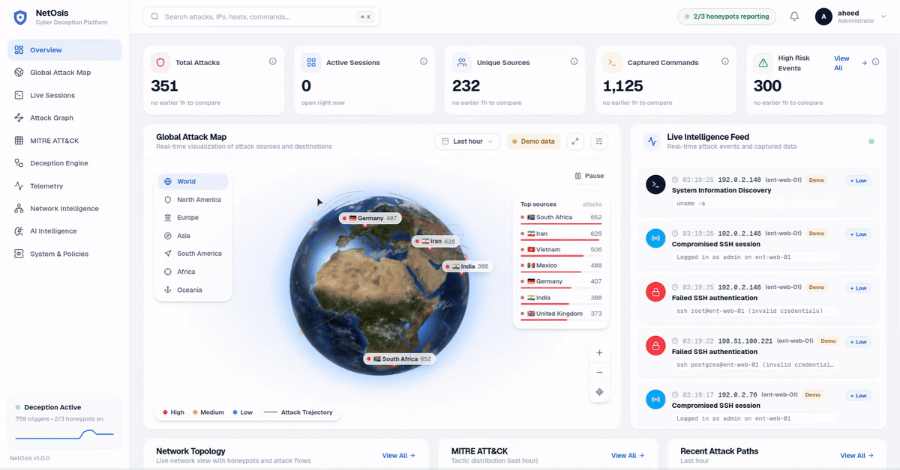

<sub>Recorded with labelled demo data (<code>scripts/soc_demo.py</code>): every demo row carries a <b>Demo</b> tag and uses documentation IP ranges.</sub>

</div>

---

## ✨ What it does

| | |
|---|---|
| 🎭 **Believable fake servers** | A full emulated Ubuntu host (users, `/etc/shadow`, logs, SUID binaries, processes, old timestamps, breadcrumbs, canaries). Pipes, chains and redirects work. Nothing the attacker types ever runs on a real machine. |
| 🧠 **Local AI for the unknown** | A deterministic engine answers most commands instantly. Anything else goes to a **local** Qwen 2.5 (Ollama) with RAG over the host's facts *and this attacker's own profile*, plus a leak filter. No cloud, no data leaves the lab. |
| 🎯 **ATT&CK on every keystroke** | Each command is mapped to a technique and tactic, scored, and added to a per-attacker profile and attack graph. |
| 🪜 **Adaptive deception ladder** | As risk rises, rungs D01 → D07 fire: expose decoy hosts, plant credentials and documents, deploy canaries, reveal network segments. |
| 🔀 **Real lateral movement** | `ssh` from one honeypot really relays to the next. A powered-off honeypot is **woken on demand** through the Proxmox API, so idle traps cost no power. |
| 📡 **Live SOC dashboard** | Globe, session replay, attack graph, MITRE matrix, deception history, telemetry explorer and live network topology, all from real events. |
| 🛰️ **Push-only node agents** | Every node reports load, services and live TCP connections. The agents open **no port**, so attackers can't reach or tamper with them. |

---

## 🎬 Features

### Live overview: click any attack on the globe
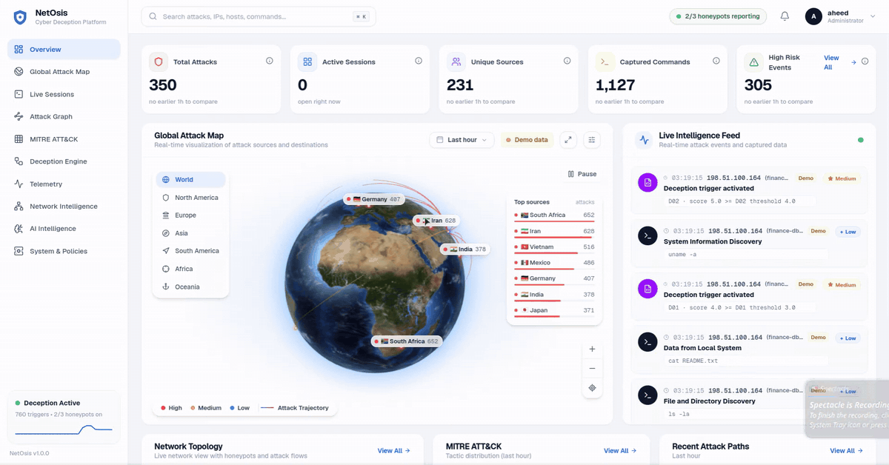

Real satellite globe with glowing attack sources, arcs into the lab and severity rings.
* **Labels:** each source has a small chip; hover or click it for the full card (profile, hosts hit, links to Sessions / Attack graph / Events).
* **No overlap:** a label that would collide with another label or a panel is hidden.
* **Data window:** every number on the page has a definition and uses the same time window.

### Session replay: watch exactly what the attacker did
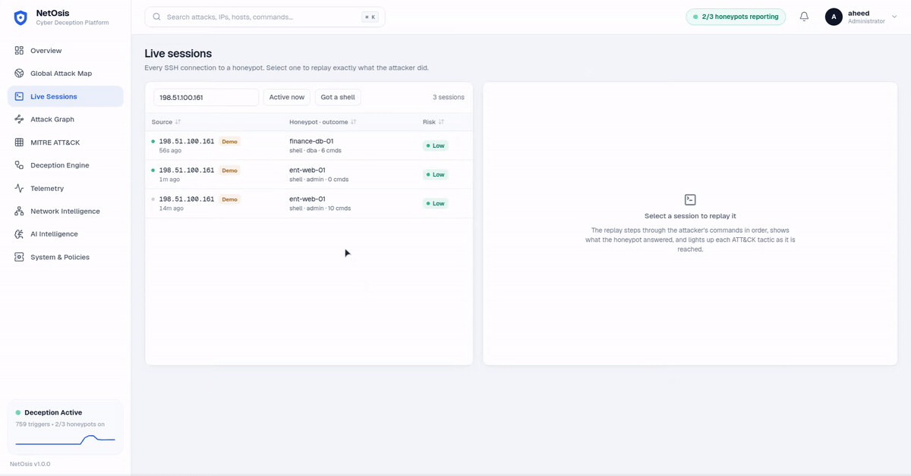

* **Replay:** every SSH connection can be replayed. Commands type out next to the honeypot's real answers.
* **Kill-chain rail:** the 12 ATT&CK tactics light up as the attacker reaches them.
* **Deception and pivots:** rungs (D01…D07) and pivots (`ent-web-01 → finance-db-01`) appear inline at the moment they happened.
* **Controls:** pause, step, scrub and change speed.

<table>
<tr>
<td width="50%" valign="top">

### 🌍 Global attack map
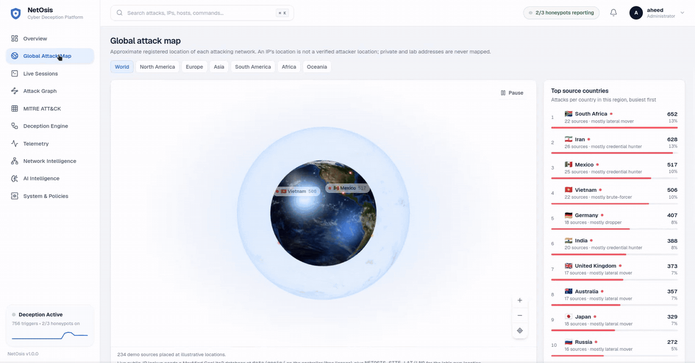

* **Country list:** sorted by attacks, with flags, severity and main attacker profile. Click a country to fly to its busiest source.
* **Honest locations:** private and lab IPs are **never** placed on the map.

</td>
<td width="50%" valign="top">

### 🗺️ Regions & drill‑down
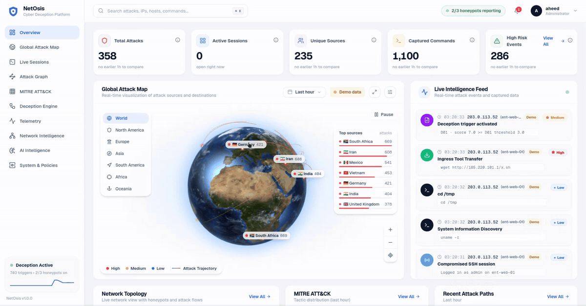

* **Region zoom:** one click zooms to a region.
* **Source card:** clicking a source opens its card with links into every other view.

</td>
</tr>
<tr>
<td width="50%" valign="top">

### 🕸️ From globe to attack graph
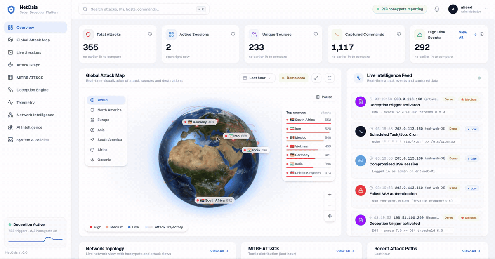

* **Graph layout:** attackers → honeypots → ATT&CK techniques.
* **Focus:** focusing one attacker shows only their path and pivots.

</td>
<td width="50%" valign="top">

### 🧭 Network intelligence
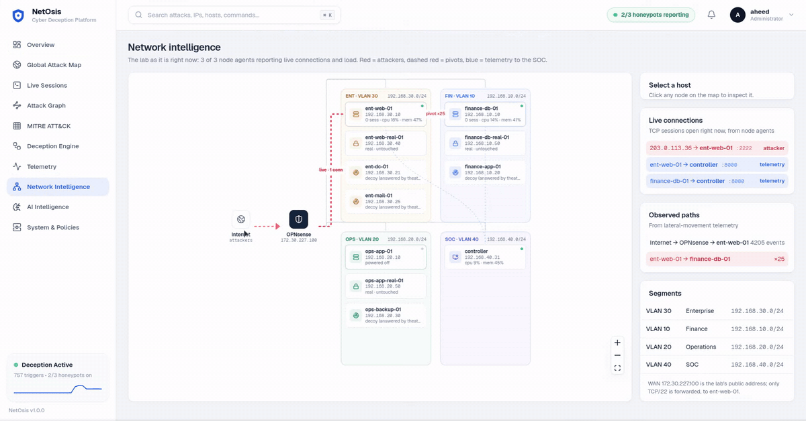

* **Live topology:** OPNsense, four VLANs, honeypots, decoys and real servers.
* **Live lines:** red = attacker connections now, dashed red = pivots, blue = telemetry. They come from node agents.

</td>
</tr>
<tr>
<td width="50%" valign="top">

### 🎯 MITRE ATT&CK
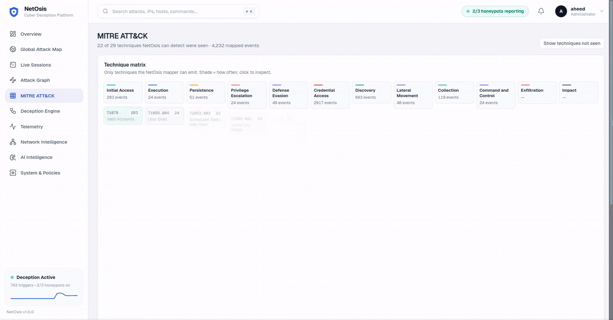

* **Matrix:** only techniques NetOsis can actually detect.
* **Detail:** the tactic donut and top techniques drill down to the exact commands.

</td>
<td width="50%" valign="top">

### 🪜 Deception engine
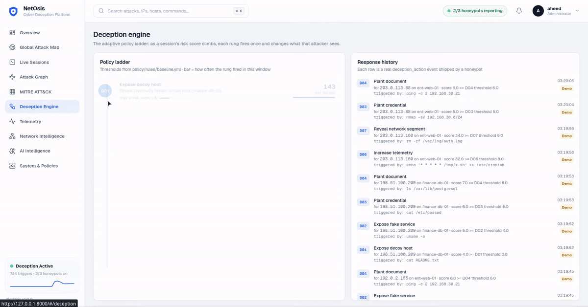

* **Ladder:** D01–D07 with real thresholds from `policy/rules/baseline.yml`.
* **History:** every fired response with its score and trigger.

</td>
</tr>
<tr>
<td width="50%" valign="top">

### 🔎 Telemetry explorer
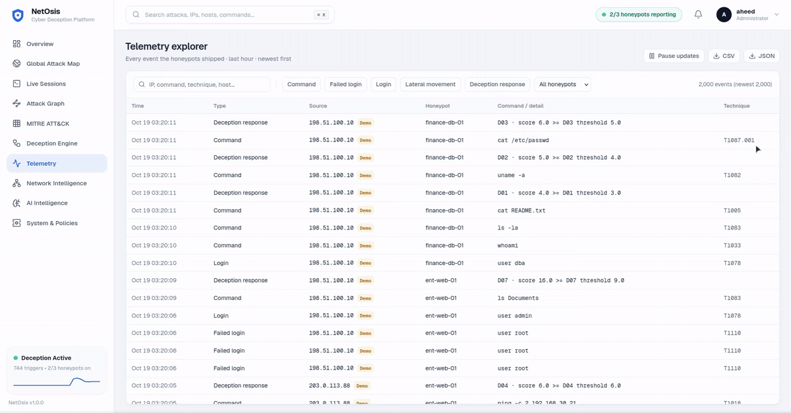

* **Search:** filter by type, honeypot or text.
* **Inspect and export:** open the raw JSON of any event; export exactly what is shown as CSV/JSON.

</td>
<td width="50%" valign="top">

### ⚙️ System & policies
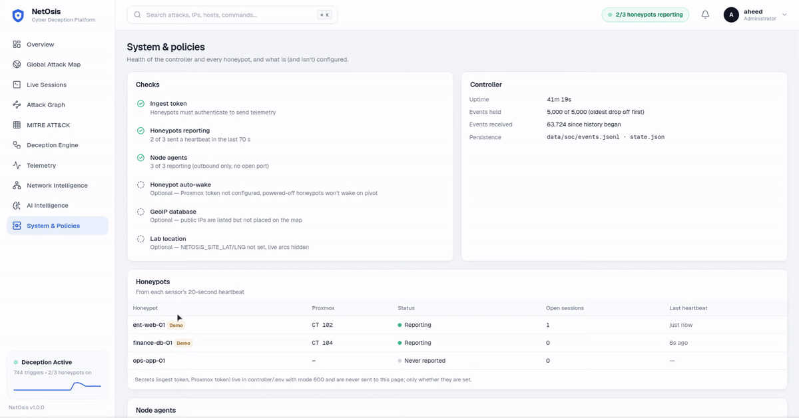

* **Health:** controller health, honeypot heartbeats and node agents.
* **Configuration:** shows what is (and isn't) configured. Secrets are never sent to the page.

</td>
</tr>
</table>

---

## 🧩 How it works

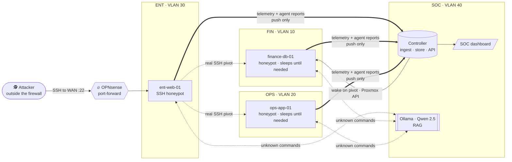

**Inside one honeypot, every command goes through this pipeline:**

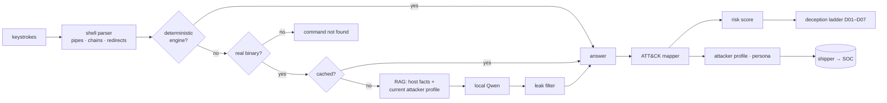

* **Who is asking?** Every connection is `actor-<ip>`, with its **own copy** of the fake host, so attackers on the same honeypot never see each other's files. The current attacker's profile is pinned into the LLM context ("CURRENT ATTACKER… credential hunter, risk HIGH"), so answers stay consistent per attacker.
* **Honest data:**
  * KPIs ship with definitions.
  * Trends compare against the real previous window.
  * Geolocation is used only for public IPs.
  * Arcs are drawn only when both ends are known.
  * Demo data is always labelled.

<details>
<summary><b>Deception ladder D01 → D07</b></summary>

| Rung | Response | Purpose |
|---|---|---|
| D01 | Expose decoy host | Lure toward the fake network |
| D02 | Expose fake service | Something worth probing |
| D03 | Plant credential | Bait for credential hunters |
| D04 | Plant document | Breadcrumbs (VPN migration notes…) |
| D05 | Deploy canary | Detect use of stolen material |
| D06 | Increase telemetry | Watch closer as risk rises |
| D07 | Reveal network segment | Invite the pivot into the next honeypot |

Thresholds and weights are in [`policy/rules/baseline.yml`](policy/rules/baseline.yml).
</details>

---

## 🧪 Quick start

```bash
git clone https://github.com/aheedkhan/NetOsis.git && cd NetOsis
python3 -m venv .venv && source .venv/bin/activate
pip install -r requirements.txt
pytest -q                                   # 85 passed
```

**Talk to a honeypot**

```bash
python scripts/ssh_honeypot.py --port 2222
ssh admin@127.0.0.1 -p 2222                 # password: admin123
```

**See the SOC dashboard with labelled demo data**

```bash
NETOSIS_INGEST_TOKEN=demo python3 controller/app.py          # http://127.0.0.1:8000
python3 scripts/soc_demo.py --token demo --speed 4 --loop     # replays 4 attacker stories through the real pipeline
```

**Local LLM (optional):** `ollama pull qwen2.5:0.5b`, then set `NETOSIS_LLM_MODE=qwen` in `.env` (see [docs/llm-local.md](docs/llm-local.md)).

<details>
<summary><b>Working on the dashboard UI</b></summary>

```bash
cd soc && npm ci
npm run dev        # http://localhost:5173, proxies /api to the controller on :8000
npm run build      # writes soc/dist; it is committed so the SOC VM needs no Node
```
Stack: React · TypeScript · Vite · Tailwind v4 · TanStack Query/Table · React Flow · ECharts · react-globe.gl · Motion · Lucide · Geist.
</details>

---

## 🚀 Deploy to the lab

Kali attacks the firewall's WAN address from outside, like the Internet would.

| Node | Role | Address |
|---|---|---|
| OPNsense (VM 101) | gateway, WAN `172.30.227.100` = the lab's "public IP" | VLAN gateways `.254` |
| CT 102 `ent-web-01` | entry honeypot (WAN :22 forwards here) | `192.168.30.10` |
| CT 104 `finance-db-01` | pivot target, auto-wake | `192.168.10.10` |
| CT 105 `ops-app-01` | pivot target, auto-wake | `192.168.20.10` |
| VM 103 controller | SOC dashboard, LLM, RAG | `192.168.40.31` |

```bash
# SOC VM: controller + dashboard + its own agent; prints the ingest token
cd /opt/netosis && bash scripts/soc-dashboard-setup.sh

# each honeypot CT: honeypot + node agent
NETOSIS_INGEST_TOKEN=<token> bash /opt/netosis/scripts/lab-bootstrap-remote.sh ent-web-01
```

Full steps: [ops/SERVER_RUNBOOK.md](ops/SERVER_RUNBOOK.md) · dashboard internals: [docs/soc-dashboard.md](docs/soc-dashboard.md).

---

## 🔐 Security model

* **No real shell, ever.** Attackers only talk to the emulated shell; commands are never executed on the host.
* **Segmented lab.** No cross-VLAN traffic except honeypot → honeypot on `:2222`; honeypots have no Internet access.
* **Write-only, token-guarded ingest.** `/v1/ingest`, `/v1/agent` and `/v1/pivot/wake` need the lab token (constant-time compare). Power-on is limited to an allowlist of honeypot CTIDs with a restricted Proxmox token.
* **Push-only agents.**
  * They listen on nothing and ignore replies.
  * Each runs as its own unprivileged user under systemd hardening.
  * The token lives in a root-only file the honeypot process can't read.
* **Secrets stay server-side.** `controller/.env` (mode 600, gitignored) is never sent to the browser.
* **Dashboard access.** Reachable only from the management jumpbox (firewall rule). Analyst login is next on the [roadmap](docs/PLAN-functional-soc.md).

See [SECURITY.md](SECURITY.md).

---

## 🗂️ Repository map

```text
deception/     fake system (system/), shell + command engine, network theater, LLM + RAG glue, personas
controller/    SOC controller: ingest, store, geo grounding, Proxmox wake, REST + SSE API
agent/         push-only node agent (stdlib)
soc/           React dashboard (src/) and its committed build (dist/)
mitre/         command → ATT&CK technique mapper
policy/        deception ladder rules and weights
rag/           ingestion + retrieval for the LLM context
attack_graph/  per-honeypot attack graph model
telemetry/     event schema
scripts/       honeypot, demo replayer, lab/SOC/agent installers
ops/           systemd units, server runbook
docs/          network, firewall, LLM, RAG, dashboard guides + media
tests/         85 unit tests
```

---

## 🛣️ Roadmap

The dashboard is real-data and interactive. The next phase makes it **operational**:
* **Foundation:** durable storage, analyst login and an audit log.
* **Triage:** alert inbox.
* **Response:** end session / quarantine IP and power controls, delivered through a pull-model action queue.
* **Detection:** exfiltration detection, a sandbox gate, then a k3s sandbox proof of concept.

➡️ [docs/PLAN-functional-soc.md](docs/PLAN-functional-soc.md)

## 📚 Docs

[Network & SDN](docs/network.md) · [OPNsense guide](docs/OPNSENSE_SDN_GUIDE.md) · [Firewall study guide](docs/NETWORKING_AND_FIREWALL_MASTER_STUDY_GUIDE.md) · [SSH honeypot](docs/ssh-honeypot.md) · [Local LLM](docs/llm-local.md) · [RAG](docs/rag.md) · [SOC dashboard](docs/soc-dashboard.md) · [Architecture](ARCHITECTURE.md)

<div align="center"><sub>NetOsis: deception that adapts, telemetry you can trust.</sub></div>
